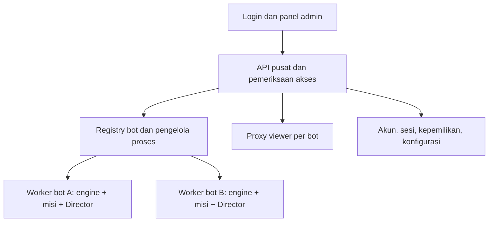

# Rancangan panel admin multi-bot — 2026-10-20

Status terbaru: **fondasi owner + worker + UI multi/single + dual kamera sudah diimplementasikan**, setelah persetujuan pemilik berikutnya. Cara pakai, hasil uji, dan batas nyata: [ADMIN_PANEL.md](ADMIN_PANEL.md). Rancangan historis di bawah bukan daftar fitur yang seluruhnya sudah selesai. Customer management, profil LLM per bot, dan SQLite masih belum diterapkan.

Tambahan yang disetujui: Eagle bot fokus tetap terlihat dalam mode multi, dengan first-person per kartu termasuk bot fokus; seluruhnya melalui satu origin dan iframe stabil saat polling.

## Temuan source

- `bot.js` membuat satu client, bot, runner, engine, lifecycle, dan API.
- `control/index.js` mengembalikan `[engine.state()]` untuk GET `/bots`; tidak ada registry atau endpoint membuat bot.
- `control/auth.js` selalu mengembalikan owner lokal. Role/capability yang dikirim belum merupakan sistem akun/customer dengan pemeriksaan akses lengkap.
- Token URL bukan sekali pakai. Tanpa `ARCADIA_TOKEN`, token dibuat acak setiap proses dimulai. `control/cookie.js` menyimpan token dalam cookie bernama per port, masa berlaku bawaan satu hari. UI menghilangkan token dari URL setelah halaman terbuka.
- Store UI sudah memisahkan state berdasarkan botId. Namun app mengambil detail bot terpilih saja dan belum menampilkan dashboard gabungan.
- ID engine berasal dari username Minecraft. Penyimpanan profil/misi/persona dan pengaturan perlu dimigrasikan agar nama yang sama pada customer/server berbeda tidak berbenturan.
- Eagle View sekarang menggunakan URL loopback dan port tersendiri. Panel yang diakses dari komputer/HP lain membutuhkan jalur viewer melalui alamat panel, termasuk koneksi Socket.IO; mengganti link saja tidak cukup.

## Arah yang disarankan

Panel admin menjadi aplikasi induk yang tetap hidup meskipun tidak ada bot online. Engine saat ini tetap menjadi executor per bot, sedangkan layanan baru mengelola akun, daftar bot, proses, dan akses.

Satu worker proses per bot direkomendasikan untuk tahap pertama: crash atau konflik state plugin satu bot lebih mudah diisolasi. Konsekuensinya RAM per bot lebih besar; batasi jumlah worker aktif dan antrekan start. Dashboard tidak membuat koneksi Minecraft baru setiap dibuka.

## Dua mode tampilan

| Mode | Isi utama | Kontrol |
|---|---|---|
| Multi / dashboard | Nama, status koneksi, health, hunger, kegiatan/task, progres ringkas, koordinat + dimensi, peringatan, waktu pembaruan terakhir | Tambah bot, cari/filter, pilih beberapa bot, start/stop/restart, jeda/lanjutkan misi, buka fokus |
| Single / fokus | Tampilan companion saat ini: GLB, percakapan, tujuan, kegiatan/langkah, ingatan, statistik, Eagle View | Kontrol detail bot terpilih, model/animasi, misi, inventory, log |

Dashboard default memakai avatar/thumbnail ringan. Model 3D hidup dan Eagle View dimuat saat fokus agar puluhan kartu tidak menyalakan puluhan renderer. Saat kembali ke dashboard, hentikan rendering yang tidak terlihat dan tampilkan status terakhir tanpa menandainya sebagai data live bila worker terputus.

Pisahkan istilah **Hentikan bot** (putuskan koneksi Minecraft) dari **Jeda kegiatan** (hentikan kelanjutan misi, bot tetap online). Aksi massal mengembalikan hasil per bot; satu kegagalan tidak boleh terlihat sebagai sukses semua. Koordinasi tugas bersama antarbot adalah fitur lanjutan, berbeda dari mengirim aksi yang sama ke beberapa bot.

## Membuat dan mengelola bot

Form Tambah bot: nama tampilan, username Minecraft, profil server, profil koneksi/auth yang didukung, model karakter, profil LLM opsional, pemilik/customer. Simpan konfigurasi terlebih dahulu; **Simpan & mulai** menjadi pilihan eksplisit.

Registry memiliki `botId` internal tetap, `tenantId`, `displayName`, `minecraftUsername`, `serverProfileId`, `modelId`, `llmProfileId`, serta preferensi autostart. Username Minecraft tidak menjadi primary key. Validasi username ganda pada server yang sama sebelum start.

Worker menerima konfigurasi tervalidasi dari pengelola, bukan perintah shell dari form. Gunakan komunikasi internal dengan request ID, timeout, heartbeat, dan generasi worker agar balasan proses lama diabaikan setelah restart. Start/stop/restart harus idempotent; disconnect memakai backoff dan batas percobaan. Restart worker memulihkan misi ke paused/uncertain sesuai mekanisme yang sudah ada, tidak mengulang aksi otomatis.

## Login dan customer

- Satu alamat panel tetap, halaman login, logout, dan sesi server dengan cookie HttpOnly. Restart worker tidak memutus sesi admin. Persistensi sesi admin memiliki masa berlaku dan pencabutan yang jelas.
- Setup owner pertama secara lokal, password di-hash, tidak ada password default bersama. Secret internal worker dan API key LLM tidak dikirim ke browser.
- Tahap pertama owner tunggal. Struktur kepemilikan dan pemeriksaan akses dibuat sejak awal supaya customer dapat ditambahkan kemudian.
- Tahap customer: admin mengelola semua customer; customer hanya dapat melihat/mengontrol bot miliknya. Pemeriksaan backend berlaku juga untuk event, file model, ingatan, dan viewer, bukan hanya menyembunyikan tombol UI.
- API lama/token lokal dapat dipertahankan sementara untuk kompatibilitas. Akses pengguna sehari-hari melalui login panel, tanpa token URL per bot.

## Data dan integrasi

Metadata akun, sesi, server, dan bot memakai penyimpanan transaksional pusat (usulan SQLite untuk deployment satu mesin; dependency dipilih saat implementasi). Data runtime bot dipisahkan berdasarkan tenantId/botId; satu worker menjadi penulis data botnya. Hindari banyak worker menulis file settings/stats yang sama. Model dapat memakai katalog bersama dengan pemeriksaan izin, sementara kalibrasi tetap per bot.

Gateway mengagregasi snapshot ringan seluruh bot dan menyalurkan satu stream event terautentikasi. Detail misi/profil baru diambil ketika fokus. Jika koneksi stream putus, UI mengambil snapshot ulang; progress boleh digabung untuk mengurangi trafik, hasil task tidak boleh hilang.

Proxy Eagle View perlu menangani HTTP, aset, dan Socket.IO upgrade/path serta memeriksa hak akses. Jangan membuka port worker/viewer langsung ke customer. Integrasi path/subdomain dipastikan lewat source prismarine-viewer yang terpasang sebelum implementasi.

Profil LLM pusat memiliki referensi secret, model/provider, dan batas penggunaan gabungan. Tiap bot dapat memilih profil; batas per bot saja belum cukup untuk menahan lonjakan panggilan dari banyak bot.

## Urutan implementasi yang dapat dievaluasi

1. **Fondasi admin:** entrypoint terpisah dari bot, login owner, registry persisten, Tambah bot, start/stop satu worker. Panel harus tetap bisa dibuka saat semua bot mati.
2. **Multi + fokus:** dua worker terisolasi, dashboard ringkas, navigasi fokus memakai UI sekarang, agregasi event dan kontrol massal dengan hasil per bot.
3. **Integrasi lengkap:** proxy viewer, model/kalibrasi, LLM profile dan batas gabungan, migrasi BotAlpha beserta ingatan/checkpoint tanpa menimpa sumber lama.
4. **Customer:** akun/role, ownership dan pemeriksaan akses menyeluruh, pengelolaan customer dari admin.

Kriteria selesai: membuka panel tanpa URL token; membuat dua bot dari UI; menghentikan satu bot tidak mengganggu yang lain; fokus menampilkan data bot yang benar; dashboard menandai data offline/stale; restart panel mempertahankan registry; restart worker tidak mengulang misi uncertain; customer tidak bisa mengakses data/event/viewer bot lain. Pengujian diarahkan ke batas proses, persistensi, dan akses tersebut.

Asumsi awal: satu mesin menjalankan panel dan worker, banyak bot dapat mengarah ke profil server berbeda, mode multi default, fokus menampilkan satu GLB/viewer aktif. Implementasi admin belum dimulai pada sesi analisis ini.
